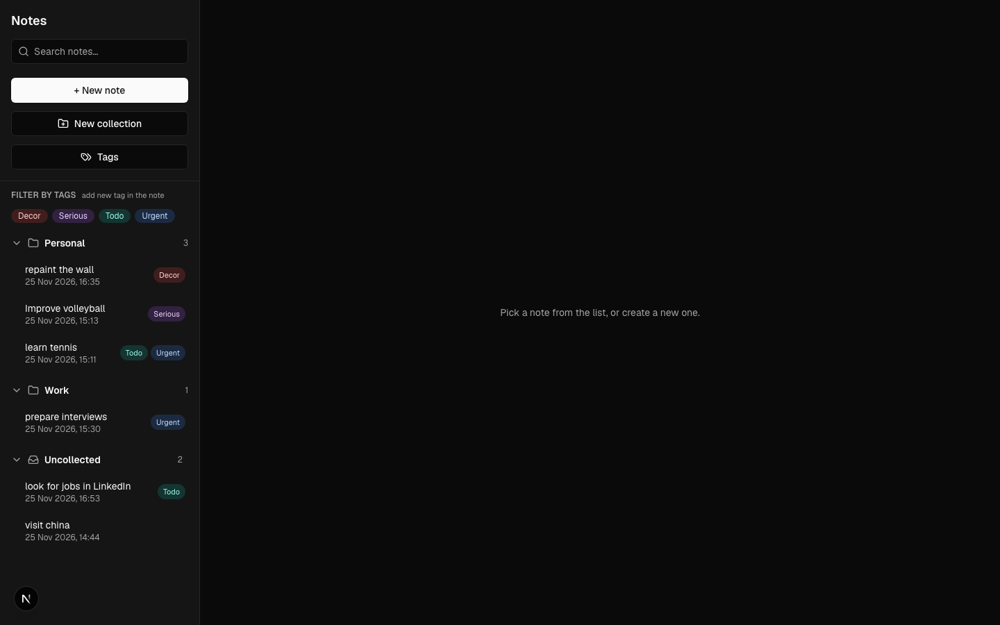

# Reflection: notes-lab

## Project summary

notes-lab is a personal notes app with collections, tags and search. It runs locally with `npm run dev`.

**Stack:** Next.js (App Router, with `cacheComponents` on), TypeScript, Tailwind CSS, and Supabase through `supabase-js`.

What the app does:

- **Notes:** create, edit and delete notes from a sidebar and an editor.
  - "New note" creates a note straight away.
  - Saving needs a title.
  - Cancel on a note that was never saved deletes it.
- **Collections:** group notes into collections, then rename or delete them. Deleting a collection moves its notes to "Uncollected"; it never deletes them.
- **Tags:**
  - Add tags to a note in the editor. Existing tags are suggested, and "work" reuses "Work".
  - Rename and delete tags in a Tags list.
  - Filter the sidebar by tags. It shows only notes that have *all* the selected tags.
- **Tag colours:** each tag has one of 8 palette colours.
  - A new tag gets the least-used colour.
  - The colour can be changed in the Tags list.
  - It shows on note cards, in the filter, in the editor and in the Tags list.
- **Search:** matches title or body, not case-sensitive, within the current tag filter.
- **State in the URL:** the open note, the filter, the search and the Tags view all live in the URL, so a reload keeps them.
- **Small screens:** the editor and the Tags list appear in the sidebar instead of on the right.

How the code is organised:

- **Data access:** every table read and write goes through one server-only module, `lib/db.ts`. Client components change data through Server Actions (`app/notes/actions.ts`), never by calling Supabase directly.
- **Schema:** every schema change is a migration made with the Supabase CLI. The schema is documented in `docs/supabase-schema.md`, which is checked against the live database.
- **Project rules:** `CLAUDE.md` records the rules and the behaviour to keep. Examples: credentials only from `.env.local`, one branch per feature, and type-check and lint before committing.

## Branches and pull requests

Each piece of work was done on its own branch and merged into `main` through a pull request. `main` starts from the commit "Baseline: notes-lab before mid-sprint project".

| PR | Branch | What it did | Merged |
|---|---|---|---|
| [#1](https://github.com/regiswilll/notes-lab/pull/1) | `refactor/db-helper` | Moved all database access into `lib/db.ts`; added `CLAUDE.md`, the schema doc, a migration and the `supabase-js` reference | 2026-11-24 |
| [#2](https://github.com/regiswilll/notes-lab/pull/2) | `feature/notes-CRUD` | Notes page with sidebar and editor: create, read, update, delete | 2026-11-24 |
| [#3](https://github.com/regiswilll/notes-lab/pull/3) | `feature/collections` | Collections: create, rename, delete, notes grouped in the sidebar | 2026-11-25 |
| [#4](https://github.com/regiswilll/notes-lab/pull/4) | `feature/tags` | Tags on notes, the Tags list, and the tag filter | 2026-11-25 |
| [#5](https://github.com/regiswilll/notes-lab/pull/5) | `feature/search` | Search over title and body, plus small-screen layout tweaks | 2026-11-25 |
| [#6](https://github.com/regiswilll/notes-lab/pull/6) | `docs/claude-md` | `CLAUDE.md` updated with how the notes page works | 2026-11-25 |
| [#7](https://github.com/regiswilll/notes-lab/pull/7) | `feature/tags-color` | Tag colours from a palette of 8, with two migrations: add the column, then fix its comment | 2026-11-25 |
| [#8](https://github.com/regiswilll/notes-lab/pull/8) | `fix/tag-suggestions-position` | Tag suggestions now open right under the tag box. They had been a native `<datalist>`, which could appear in the wrong place | 2026-11-25 |

Local branch with no pull request: `chore/claude-commands`. It adds the `/full-review` and `/refactor-clean` slash commands in `.claude/commands/`, and is not merged.

## Third-party slash command finding

Download the full-review.md and refactor-clean.md command files from the GitHub repository wshobson/commands (look in its tools/ and workflows/ folders) into .claude/commands/ in this project. /full-review could not run initially, with some skills missing, so I let Claude rewrite it to be able to run.

this one was fixed:
1. CLAUDE.md doesn't explain how to change the palette.
    * The 8 colour names appear in 5 places: the migration (3 times), lib/tag-colors.ts and the schema doc.
    * Adding a colour only in lib/tag-colors.ts makes the database reject it, with a raw error. Adding it only in the database makes it show as blue.
    * Fix: add a line saying a palette change needs a new migration that replaces the colour rule, and that lib/tag-colors.ts must not import any server-only code, because the browser also uses it.

## Fresh-session review finding

1. Wrong path in the migration comment. It says the palette is in app/notes/tag-colors.ts, but it is in lib/tag-colors.ts. The new migration has already been applied, so the branch didn't fix the comment and documented the error in CLAUDE.md instead. That's acceptable, but it leaves a permanent note in CLAUDE.md about a mistake. A cleaner fix would be correcting the path in the doc comment on the column, or in the next migration that touches colours.
2. Schema doc not regenerated from the live database. The header of docs/supabase-schema.md still says "Read from the live database … on 2026-11-24, after migration 20261124114513". The color row looks hand-written. Either regenerate the doc as its "Regenerating" section describes, or update the header line. The doc also doesn't mention the new column comment, though its other tables don't list comments either.

## Optional task(s)

colour-coded tags

## Problems I hit and how I fixed them

'save' was not triggered in the right way, add function missing for tags, drawdown menu location wrong.
Mostly I let Claude fix issues that are not related to each other in one step. check each fix and see if any other problem surfaces.

## What I would do differently

generally it was good. next time , I should picture more in details for each CRUD functions for each item.
